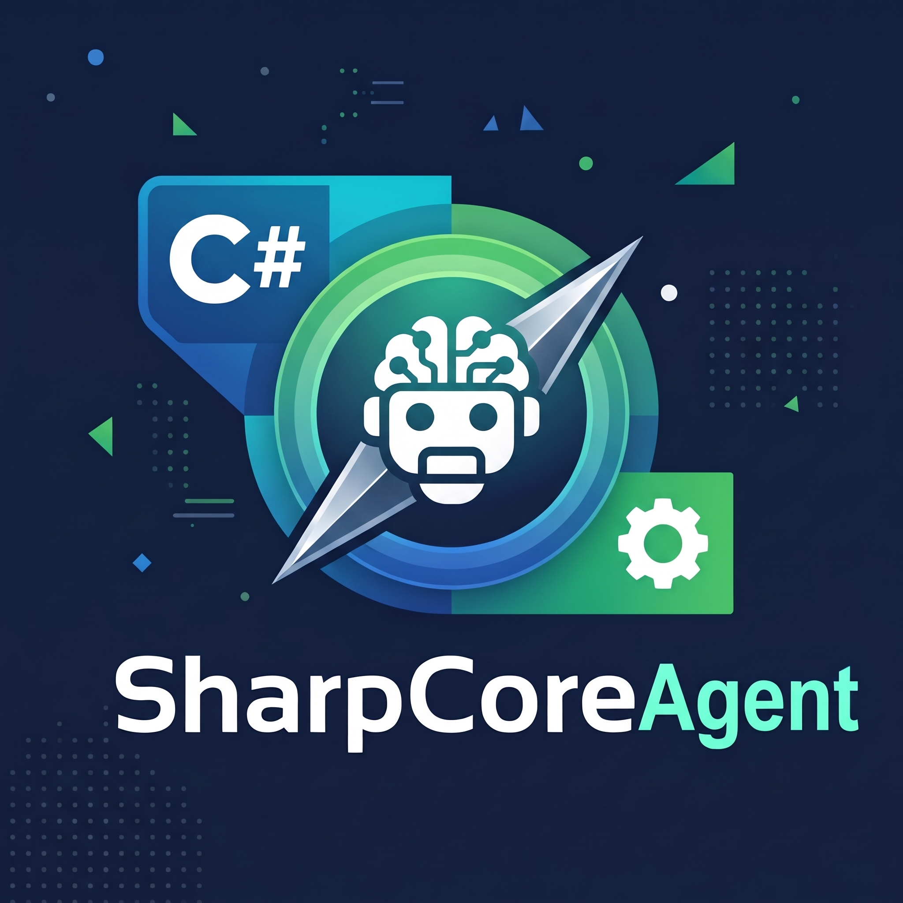

<p align="center">
  
</p>

<h1 align="center">SharpCoreAgent</h1>

<p align="center">A terminal-first coding agent for <strong>C# 15 / .NET 11</strong>, built around <strong>DeepSeek</strong> and <strong>Grok</strong>.</p>

<p align="center">
  
  
  
</p>

<p align="center">
  <a href="https://sonarcloud.io/summary/new_code?id=MPCoreDeveloper_SharpCoreAgent">
    
  </a>
  <a href="https://sonarcloud.io/summary/new_code?id=MPCoreDeveloper_SharpCoreAgent">
    
  </a>
  <a href="https://sonarcloud.io/summary/new_code?id=MPCoreDeveloper_SharpCoreAgent">
    
  </a>
  <a href="https://sonarcloud.io/summary/new_code?id=MPCoreDeveloper_SharpCoreAgent">
    
  </a>
</p>

SharpCoreAgent reads a repository, edits it, runs the build and the tests, and reports what it changed.
The model is swappable by design: DeepSeek and Grok ship as dedicated, tested adapters, and any other
OpenAI-compatible endpoint is reachable through configuration — no rebuild, no new project.

## What it does

- **One request becomes a verified change.** The agent explores the workspace, edits files, runs the
  build and reports the outcome instead of claiming success.
- **The model is a port, not a dependency.** `SharpCoreAgent.Domain` names no vendor, no HTTP type and
  no wire format; every provider lives behind `IChatModel` in the infrastructure layer.
- **Tools are the only door to the machine.** Reading, writing, deleting and shell access all go
  through a registered tool with a JSON Schema, a safety class and a recorded result.
- **Every loop has a budget.** Iterations, output tokens, total tokens and tool-result size are capped
  and enforced, so a confused model cannot spend the night on your account.
- **Streaming is the default.** Text, reasoning deltas and tool calls arrive as they happen, in
  human-readable form or as one JSON event per line (`--json`).
- **Colour when it helps, never when it hurts.** Glyphs, tools, paths, timings and diffs are coloured on
  a terminal; `NO_COLOR`, `--color never` and any redirected stream keep the output plain UTF-8, and
  `--json` never carries an escape.
- **Edits are fragments, not rewrites.** `replace_in_file` changes only the text the model matched, and
  the approval prompt shows a unified diff of the change before the answer is read.
- **Plan before act.** `--mode plan` (or `/mode plan`) hides every destructive tool and asks for a plan,
  so a risky change can be reviewed in the same transcript that then carries it out.
- **A sub-agent keeps the investigation out of your transcript.** `task` runs one instruction in a child
  agent with its own context and hands back only the answer, while the child's edits and commands are
  still reported as this turn's effects and still wait on `dotnet_verify`.

## Requirements

- .NET SDK **11.0.100** or later preview (`global.json` pins the RC build; install that one or a
  roll-forward-compatible SDK)
- Windows, Linux or macOS (the shell tool picks `cmd.exe` or the Unix shell at construction time)
- API keys for the providers you intend to use; the `demo` provider needs none

**Supported runtime**: `net11.0` and newer — 11 is a floor, not a ceiling. .NET 10 and older, .NET
Framework and .NET Standard are refused by the build itself (`Directory.Build.targets`, error
`SCA0001`), because the code and the SharpCoreDB packages it depends on are written against .NET 11
APIs. Later frameworks are not blocked, but they do not exist yet: .NET 12 ships a year after 11, and
until an SDK that supports it is installed, targeting `net12.0` fails on its own with `NETSDK1045`.
The language level is C# 15 (`LangVersion=preview`) and the only place that is configured is
`src/Directory.Build.props`.

## Install

`sharpcoreagent` is a .NET tool: one framework-dependent package and no per-platform binaries, so the
same install command works on Windows, Linux and macOS. It needs the .NET 11 SDK or runtime named in
*Requirements* and nothing else.

```powershell
dotnet tool install --global sharpcoreagent
```

That puts `sharpcoreagent` on your `PATH`; open a new terminal so the shell picks it up. Run it from a
repository root and that directory is the workspace — the agent reads and edits the repository it was
called from, with no project file to point at:

```powershell
cd C:\path\to\your\repository
sharpcoreagent                                 # an interactive session in this directory
sharpcoreagent run "summarise what changed in src" --provider deepseek
```

`--workspace <path>` names a different root for one invocation, and `--add-root` attaches a second
repository read-only.

### Install from a GitHub release

Every [release](https://github.com/MPCoreDeveloper/SharpCoreAgent/releases) carries the same `.nupkg`
and a framework-dependent binary per platform (`win-x64`, `linux-x64`, `osx-arm64`), for a machine that
would rather not use nuget.org. Download the `.nupkg` and install from the folder that holds it:

```powershell
dotnet tool install --global sharpcoreagent --add-source C:\path\to\downloads
```

### Update and remove

```powershell
dotnet tool update --global sharpcoreagent
dotnet tool uninstall --global sharpcoreagent
```

## Quickstart from source

```powershell
git clone https://github.com/MPCoreDeveloper/SharpCoreAgent.git
cd SharpCoreAgent

dotnet build .\SharpCoreAgent.slnx -c Release
dotnet test  .\SharpCoreAgent.slnx -c Release
```

Prove the loop without credentials (deterministic, offline, no key):

```powershell
dotnet run --project src\SharpCoreAgent.Cli -- models
dotnet run --project src\SharpCoreAgent.Cli -- run "list the files in this repository" --provider demo --approval readonly
```

Build the index once per clone. Nothing does it for you: `search_code`, `find_symbol`, `find_references`
and `code_context` answer from the index, and without one they say so instead of guessing:

```powershell
dotnet run --project src\SharpCoreAgent.Cli -- index
```

Start a session the way every other agent in a terminal starts one — type the name. With a terminal on
both ends it opens the interactive loop and says what it is using; with either stream redirected it
prints the usage block instead, so a script never hangs on a prompt:

```powershell
dotnet run --project src\SharpCoreAgent.Cli -- --provider demo --workspace .
```

A live DeepSeek turn, and the same prompt on Grok. Neither names a model, so each runs on the default
the provider publishes today — `deepseek-flash` and `grok-4.7`:

```powershell
$env:DEEPSEEK_API_KEY = "<your key>"
dotnet run --project src\SharpCoreAgent.Cli -- run "fix the failing test in src" --provider deepseek

$env:XAI_API_KEY = "<your key>"
dotnet run --project src\SharpCoreAgent.Cli -- chat --provider grok --model grok-4.7

# DeepSeek now, Grok if DeepSeek returns 401 or 5xx: both keys must be set.
dotnet run --project src\SharpCoreAgent.Cli -- chat --provider deepseek --fallback grok:grok-4.7
```

A key in the environment is inherited only by processes started after it was set, so a new editor
window or a restarted terminal may not see one. A credential file has neither problem, and its keys
win over the environment when both are present:

```powershell
# .\.secrets.env, which .gitignore already covers: one NAME=value per line.
# DEEPSEEK_API_KEY=<your key>
dotnet run --project src\SharpCoreAgent.Cli -- run "fix the failing test in src" --credential-file .\.secrets.env

# Or name the file once for every future shell and every editor.
setx SHARPCOREAGENT_CREDENTIAL_FILE "D:\keys\.secrets.env"
```

With no key at all and a terminal on both ends, the first run asks instead of failing: it names the
variable it needs, reads a pasted key with the echo off, writes it to `credentials.env` beside the settings
file — outside every workspace, readable by its owner only on Unix — and records that path as the
`credential-file` setting so the next run finds it. The key is never printed, logged or put in a transcript.
On a pipe, in a script or after an `n`, nothing is asked and the three documented routes are printed
instead. `--credential-file` and `SHARPCOREAGENT_CREDENTIAL_FILE` still win: a file the developer named is
where the paste goes.

## Providers

| Provider key | Models | Credential |
|---|---|---|
| `deepseek` | `deepseek-flash` (default), `deepseek-v4-pro`, `deepseek-chat`, `deepseek-reasoner` (no tools) | `DEEPSEEK_API_KEY` |
| `grok` | `grok-4.7` (default), `grok-4`, `grok-3`, `grok-3-mini` | `XAI_API_KEY` or `GROK_API_KEY` |
| `openai-compatible` | any model the endpoint serves (`--base-url` required) | `OPENAI_API_KEY`, `SHARPCOREAGENT_OPENAI_COMPATIBLE_API_KEY` or `SHARPCOREAGENT_API_KEY` |
| `demo` | `demo-scripted` (deterministic, for tests and demos) | none |

`deepseek` is the default provider. `models` prints the catalogue of the build you have, including
whether each model accepts tool calls and whether it reads images — `grok-4.7`, `grok-4`, `grok-3` and
every `openai-compatible` model declare `images=yes`, which is what `view_image` checks before it opens a
file.

## Commands and options

```
sharpcoreagent [options]                     a session in the current directory
sharpcoreagent run "<prompt>" [options]      one turn, then exit
sharpcoreagent chat [options]                interactive loop
sharpcoreagent models [--provider <name>]    list the models this build knows
sharpcoreagent index [options]               build, inspect or repair the code index
sharpcoreagent config [show|get|set|unset|path]   settings, and where each value comes from
sharpcoreagent setup                        the preferences, asked for one at a time
sharpcoreagent mcp serve [options]          this workspace's index as an MCP server on stdio
sharpcoreagent mcp config --client <name>    the block that adds it to claude, vscode, visualstudio or codex
sharpcoreagent ui --serve [options]          this workspace's index as a page on 127.0.0.1
sharpcoreagent ide agent [--write]           the profile that puts this agent in an editor's picker
sharpcoreagent ide tasks [--write]           the task that rebuilds the index, for .vscode/tasks.json
sharpcoreagent --help | --version
```

### Settings you keep

Flags describe one invocation; `config` describes this developer. It writes one JSON document —
`%APPDATA%\sharpcoreagent\config.json` on Windows, `$XDG_CONFIG_HOME/sharpcoreagent/config.json` or
`~/.config/sharpcoreagent/config.json` elsewhere, or whatever `SHARPCOREAGENT_CONFIG` names:

```powershell
sharpcoreagent config                              # every setting, its value and its source
sharpcoreagent config set provider grok
sharpcoreagent config set approval readonly
sharpcoreagent config set model grok-4.7
sharpcoreagent config set planner grok:grok-4.7      # plan turns on Grok, act turns on the rest
sharpcoreagent config get provider                 # one value, alone, for a script
sharpcoreagent config unset approval               # the built-in default applies again
```

The command line beats the environment, which beats the file, which beats the built-in default, and
`config show` prints which layer each value came from. The file never holds a key: `config set api-key`
is refused, because a preferences file is copied and committed — `--credential-file` is where a key
goes. `config show` reports only whether the provider's credential is *present*, never its value, and a
file the build cannot apply exits 7 with the key named, so `config set`/`config unset`/`config path`
keep working on the file that needs repairing.

| Option | Commands | Default |
|---|---|---|
| `--provider <name>` | run, chat | `deepseek` |
| `--model <id>` | run, chat | provider default |
| `--planner <model>` | run, chat | session model — what a plan turn runs on, e.g. `grok:grok-4.7` |
| `--executor <model>` | run, chat | session model — what an act turn runs on |
| `--reviewer <model>` | run, chat | session model — where `/review` sends its read-only turn |
| `--fallback <provider:model>` | run, chat | none — a 401 or 5xx is replayed once there |
| `--workspace <path>` | run, chat, index | current directory |
| `--add-root <path>` | run, chat | none — a read-only root the read tools may also answer from; repeatable |
| `--web` | run, chat | off — `fetch_url` may read http and https pages; the network is off otherwise |
| `--web-allow <host>` | run, chat | none — also read this host, whose address is loopback, private or metadata; repeatable |
| `--fsharp` | run, chat | off — `file_diagnostics`, `uses_at` and `signature_at` may ask the F# type checker; off otherwise |
| `--mcp <command>` | run, chat | none — start this MCP server and offer its tools as `<server>_<tool>`; repeatable |
| `--client <name>` | mcp config | none — `claude`, `vscode`, `visualstudio` or `codex`: whose configuration the printed block is for |
| `--write` | mcp config, ide | off — merge the block into that file, or write the profile or the task, instead of printing it |
| `--approval <mode>` | run, chat | `ask` |
| `--max-iterations <n>` | run, chat | `400` — a turn that reads, edits, builds and retests is tens of model calls |
| `--max-output-tokens <n>` | run, chat | `8000` |
| `--max-total-tokens <n>` | run, chat | `10000000` — the ceiling a session starts with; `/budget` raises it |
| `--temperature <x>` | run, chat | `0.2` |
| `--base-url <url>` | run, chat | none — required by `openai-compatible` |
| `--credential-file <path>` | all | none — `NAME=value` keys read first; they win over the environment |
| `--session <path>` | run, chat | `<workspace>/.sharpcoreagent/sessions/<timestamp>.json` |
| `--no-session` | run, chat | off — write no transcript |
| `--json` | run, index, ui | off — one JSON object per event, per index report, or the panel's endpoint |
| `--serve` | ui | the panel: `ui` has no other action, so `ui` alone exits `2` |
| `--port <n>` | ui | `0` — `0`–`65535`; `0` picks a free port, and one that cannot be bound exits `2` with the port named |
| `--refresh` | ui | off — walk the index before each answer, inside `--index-budget` |
| `--color <mode>` | run, chat, models | `auto` — `auto`, `always`, `never`; `auto` honours `NO_COLOR`, `TERM=dumb` and redirection |
| `--mode <mode>` | run, chat | `act` — `plan` advertises and allows only read-only tools |
| `--quiet` / `--verbose` | run, chat | off / off — `--verbose` also names each turn as it starts |
| `--` | run | everything after it is part of the prompt |
| `--no-index` | run, chat | off — no index read, write or refresh in this process |
| `--no-refresh` | mcp serve | off — answer from the index as it is, with no walk before a call |
| `--index-budget <ms>` | run, chat | `3000` — the refresh ceiling; `0` keeps reads and stops refreshing |
| `--status` | index | off — coverage and freshness; never writes |
| `--rebuild` | index | off — empty every table, build from scratch, then compact what it left |
| `--verify` | index | off — drift against the workspace; never writes, exits `1` on drift |
| `--prune` | index | off — drop rows for files that no longer exist |
| `--compact` | index | off — give back the pages the index file no longer uses; a rebuild does it too |
| `--embedder <mode>` | index | `hashed-local` — the only mode in this build |
| `--tier <name>` | index | `lean` — the only tier in this build |

Environment: `SHARPCOREAGENT_PROVIDER`, `SHARPCOREAGENT_MODEL`, `SHARPCOREAGENT_PLANNER_MODEL`,
`SHARPCOREAGENT_EXECUTOR_MODEL`, `SHARPCOREAGENT_REVIEWER_MODEL`, `SHARPCOREAGENT_WORKSPACE`, and
`SHARPCOREAGENT_ADD_ROOTS` for the read-only roots `run` and `chat` start with, separated by the
platform's path separator (`;` on Windows, `:` elsewhere). Command-line roots come first. There is
deliberately no `SHARPCOREAGENT_WEB` and no `SHARPCOREAGENT_MCP`: the network is turned on by typing
`--web` and a program is started by typing `--mcp`, in the process that wants them, and nothing a shell
or a CI image exports can grant either on the developer's behalf.

In `chat`, the loop understands `/model grok:grok-4` (switch provider and model without losing the
conversation), `/model ds`, `/model r1`, `/model grok` (aliases), `/roles` (what each job runs on),
`/review [focus]` (one read-only turn on the reviewer's model, inside this transcript), `/approval`,
`/mode plan|act`, `/compact [n]`, `/budget [n|+n|unlimited]`, `/continue`, `/usage`, `/cost`, `/files`,
`/session`, `/roots`, `/help` and `/exit` (or `/quit`).

Three jobs, three models. `--planner`, `--executor` and `--reviewer` name the model a plan turn, an act
turn and `/review` run on — planning on the model that reasons best, execution on the one that is fastest
or cheapest, review on a third opinion — and the same three names are settings and environment variables
(`SHARPCOREAGENT_PLANNER_MODEL`, `SHARPCOREAGENT_EXECUTOR_MODEL`, `SHARPCOREAGENT_REVIEWER_MODEL`). A role
nobody named runs on the session model, so naming none changes nothing; a role that *is* named wins for its
mode, and `/mode` says which model it moved to. Every named role's provider is checked for a key before the
first turn, so a missing `XAI_API_KEY` on `--planner grok:grok-4.7` is an exit `3` at startup rather than a
failed plan turn an hour later. `/review` runs its turn with writes refused and puts the approval mode and
the model back afterwards: it reads the transcript, it does not become it.

A session says what it is and what it spent. A bare `sharpcoreagent` opens on a box naming the workspace,
model, approval mode, mode and budget; the prompt reads `<model> · <mode> ❯`; each tool call is one
`⏺ name {args}` line with a `  ⎿ ok · 12 ms` result (or `⎿ error`) under it; and every turn closes with
`✻ completed · n iteration(s) · … in / … out · … tokens`, so the budget is a number on screen instead of a
surprise. `--max-total-tokens` is the ceiling a session *starts* with, a resumed transcript starts with the
tokens it already recorded as headroom, and `/budget` is how a running conversation gets more room:
`/budget` reports, `/budget +50000` adds, `/budget 400000` sets and `/budget unlimited` removes it for this
session — never written to settings, because a raised budget is a decision about one conversation. When the
ceiling is reached mid-work the loop offers to continue with more and replays the same request instead of
ending the session, and at four fifths of the way it says so once, with the command that raises it; a turn that
finishes *past* the ceiling says instead that the next request will be refused. Answering `n` to that offer
leaves the request *paused* rather than ending the conversation: the prompt reads
`<model> · <mode> · paused ❯`, and `/continue` — or a bare Enter — carries on with the request that is still
the last message in the transcript, so nothing has to be retyped. Leaving while paused exits `4`, because the
transcript holds unfinished work. The
check sits before each request rather than after each answer, so the answer you already have is never
discarded for being one token over: a `run` that finishes over its ceiling still prints the answer and
`614/1,000 tokens` in its last line. Below 1 000 tokens neither `--max-total-tokens` nor `/budget`
accepts a ceiling, because one request costs more than that.

`/usage` counts tokens; `/cost` prices them. The price table is one file with one date, printed with
every report, and each entry names the page it was read from — as of 2026-10-27 that prices
`deepseek-flash`, `deepseek-v4-pro` and `grok-4.7`. Two rules keep the number honest: a model with no
published price reports `no price known` rather than `$0.00`, and a provider that reported no usage
reports `cost unknown`; when no line can be measured at all, the total itself reads `unknown`.
DeepSeek bills an off-peak and a peak tier with peak at exactly double, and a usage report says
neither which tier ran nor whether the prompt hit the cache, so the table holds the peak cache-miss
rate: the report is the ceiling of what the turn could have cost.

`--fallback grok:grok-4.7` names the model a turn is replayed at when the primary returns 401 or a 5xx
(mid-session retirement, an expired key, a provider having a minute). Nothing else moves: a 400 would
fail the same way twice, a dropped connection is retried in place first, and a turn that has already
started streaming is never silently restarted. The replay changes one field of the request — the model
identifier — and the CLI checks both credentials before the first turn, because a fallback whose key is
missing cannot cover the failure it exists for. When it happens the terminal says so on stderr
(`fallback: deepseek:deepseek-chat failed with HTTP 401; grok:grok-4.7 answered`), the report carries
both attempts, and `/cost` bills the tokens to the model that actually answered.

Exit codes: `0` turn completed, `1` turn failed, `2` bad command line, `3` missing credential,
`4` budget exhausted or interrupted, `5` transcript I/O, `6` the index could not be created, written or
read. `index --verify` exits `1` when it finds drift, because a script that checks an index before a
build wants that answer in its control flow.

## Approval modes

| Mode | Behaviour |
|---|---|
| `readonly` | only read-only tools run; writes, deletes and shell commands are refused, and the refusal is reported back to the model |
| `ask` (default) | read-only tools run; destructive tools prompt for a decision |
| `allow` | everything runs unattended — for trusted workspaces and CI only |

In `ask` the question is `allow run_shell_command? <summary> [y/t/a/N]`, with the keys spelled out on the line
above it. `y` runs this call once, `t` runs every later call of the same tool for the rest of the session, `a`
(`all`, `always`) runs every destructive tool, and anything else — an empty line, end of input, a word nobody
meant — refuses, which is what keeps `sharpcoreagent run "…" < /dev/null` safe. `t` is the answer that stops
the questions without also waving through every file write; `/approval` reports what a session has stopped
asking about and `/approval forget` revokes it. Neither yes is written to settings nor carried into the next
session: a standing approval belongs to the conversation that earned it.

## Tools

`list_directory`, `read_file`, `view_image`, `search_text`, `list_roots`, `write_file`, `replace_in_file`,
`delete_file`, `run_shell`, `shell_output`, `shell_stop`, `dotnet_verify`, `task`.

`dotnet_verify` builds or tests the workspace and answers with a report rather than a log: exit code,
`passed`/`failed`, warnings, the diagnostics themselves, test counts, duration and the summary MSBuild
printed, followed by the SDK's own output. It is the one tool with authority over a turn's ending — a turn
that created, modified or deleted a `.cs`, `.vb`, `.fs`, `.csproj`, `.vbproj`, `.fsproj`, `.props`,
`.targets`, `.sln` or `.slnx` file cannot complete until `dotnet_verify` has passed *after* that edit. The
loop asks twice, then accepts the answer and says so: `⚠ no passing dotnet_verify ran after the last .NET
edit.` beside the outcome, and `"unverified": true` in `--json`. A failed build is an error result carrying
every diagnostic, so the model fixes the compiler's complaint instead of repeating it:

```text
✻ completed · 4 iteration(s) · 6.2s · 12,345 in / 678 out
  ⚠ no passing dotnet_verify ran after the last .NET edit.
```

`run_shell` is still the tool for everything else — it is not the tool for proving a .NET edit, and the
system prompt now says so.

`list_roots` reports the primary root and every read-only attached root, and it is the one tool result
that prints an absolute path: naming the legal ones is its whole job.

`view_image` is how a picture enters the conversation. It reads a `.png`, `.jpg`, `.jpeg`, `.gif` or
`.webp` from the workspace or an attached root, up to 4 MiB, and answers with the image itself attached to
the message that follows — the tool role carries text only, because every OpenAI-compatible provider
rejects an image there, so the loop hands the picture over on the next user message. It refuses before
reading a byte when the session's model is not declared to read images, and the refusal names the model, so
a text-only turn says it cannot see the picture instead of describing one it never saw. `models` prints
`images=yes` or `images=no` for every model this build knows. The output of the MCP client's browser
screenshot is already a file under `.sharpcoreagent/artifacts/`, which is the commonest path in:

```text
view_image · .sharpcoreagent/artifacts/npx-browser_take_screenshot-1.png (image/png · 36,912 bytes) is attached to the next message.
```

A session file keeps the transcript's text and not its images: a screenshot is megabytes of base64 on one
line of a document people grep, and the file it came from is still on disk and one `view_image` call away —
the sentence `call the tool again — view_image if the picture is a file on disk — rather than describing what
you remember` is what survives the reload.

A picture arrives through two other doors, and since round 10 it arrives whole through them as well. An MCP
server that answers with an `image` part has it attached beside the sentence that describes it: the sink
still writes the file and still names the path, because that is what a resumed transcript keeps, but the
bytes also go to the model that can see them instead of costing a `view_image` call on a screenshot the
client already had in hand. `fetch_url` returns a picture when the response is one of the four types a
provider accepts (`image/png`, `image/jpeg`, `image/gif`, `image/webp`), the body arrived whole, and the
session's model can see — an `image/jpg` is relabelled `image/jpeg`, an `image/svg+xml` is still refused by
name, and a body cut at the fetch ceiling is refused rather than attached, because half a PNG is not a
picture. Four pictures per tool result is the ceiling; every one that is not attached is named with its
number and its reason, and a session whose model is declared text-only is told the picture was not
attached rather than left to describe what it was never shown.

Those three doors share one ceiling, and it belongs to the turn rather than to any of them: 16 MiB of
picture. An attached picture is re-sent on every request that follows it, so a turn that shows four
screenshots on each of fifteen rounds would pay for sixty of them in its last request — more than a
provider accepts, refused with a status code that mentions no images. The loop is the only place that
sees a whole turn, so it counts what has travelled and tells each tool what is left; a picture that does
not fit is refused with both numbers (`this turn has 1.2 MiB of image budget left and the picture is
4.0 MiB; a new turn starts with a fresh budget`) instead of being encoded into a request that fails
later. A new turn starts with all of it, which is what makes that advice actionable. Nothing about a
picture that *does* fit changes: the file is still written, the path is still named, and the bytes
travel on the next user message.

A picture the conversation already carries is not attached a second time. Asking for the same
screenshot on ten rounds — or a page that answers with the same image on every fetch — used to add ten
copies of the same bytes, and every request after the tenth paid for all of them; round 11's ceiling
bounded that spend without reducing it, and asking again in a new turn is precisely what made it worse.
The loop collects what the transcript holds when a turn starts and tells every tool, so `view_image`, an
MCP `image` part and a `fetch_url` picture all answer a duplicate with a sentence and no second copy
(`'shots/shot.png' (image/png · 400,000 bytes) is not attached again: the same picture is already in this
conversation, attached to an earlier message`). That answer is a *success*, because the picture is exactly
where the model asked for it to be, one message earlier: a refusal would read as "you cannot see it", and
a model told that describes what it imagines. Identity is the picture — its type and its bytes — and never
the name it arrived under, so a file rewritten in place or a page that changed is a new picture and
travels. The set is derived from the transcript rather than remembered, which is what makes `/compact`,
`--resume` and the boundary between two turns right without a special case for any of them.

`task` delegates one self-contained investigation to a sub-agent. The child starts with an empty transcript and
sees only the prompt it was given, works with the session's tools minus `task` so it cannot delegate again, and
answers with one message that comes back as the tool result — with its created, modified, deleted and command
effects attached, so a delegated `.cs` edit still waits on `dotnet_verify` before your turn may end. It inherits
`allow` only from an `allow` session and is `readonly` otherwise, `ask` included, and it never prompts: a refusal
arrives as text it has to work around instead of a question in the middle of your turn. The child narrates two lines —
one when it starts and one when it finishes — and its token spend is in the second, not in `/cost`, because there is
no channel from a tool result back into session usage:

```text
task · find every caller of PriceCalculator · 6 model calls · 18,940 tokens
```

`fetch_url` is the nineteenth tool, and one of three flags that add tools to the registry. `--web` adds this
one for a single invocation, and without the flag it is absent from the registry, from the definitions the
model sees and from the system prompt. `--fsharp` adds the three that ask a type checker, `--mcp` adds
whatever each server offers, and no flag can remove a tool from the eighteen a build starts with. Of the
three, `fetch_url` is the one the system prompt has to be told about, because its absence is a *network*
decision rather than a capability one. It reads one absolute `http`/`https` URL, follows at most five
redirects, and answers with the final URL, the status, the content type, the byte count and whether the
text was cut. It sends one `User-Agent` and nothing else — no cookie, no referer, no credential — and it
refuses a host that resolves to a loopback, private, link-local or cloud-metadata address unless
`--web-allow` names it, on every hop rather than only the first. HTML is reduced to readable text in this
repository (entities decoded, `script`/`style` removed, tags stripped, whitespace collapsed), and a
response that is a picture becomes the picture instead of text — one of the four types a provider accepts,
not cut at the ceiling, and only when the session's model can see it. Everything else that is not text is
refused by type rather than decoded, which is the sentence round 2 fixed and round 10 reworded rather than
removed. There is no JavaScript, no cookie jar and no search engine of its own — `--mcp` with a search
server supplies one, below:

```text
url          https://example.com/docs/changelog
status       200 OK
type         text/html; charset=utf-8
bytes        18402
truncated    yes
redirected   from https://example.com/docs

changelog: 4.2.0 — …
```

`--fsharp` registers three tools that ask a type checker rather than read bytes: `file_diagnostics` (what
the compiler says about one file), `uses_at` (every site the compiler bound to one declaration, given the
line and column of one occurrence) and `signature_at` (what a callable takes, and which argument the
position is inside). `FSharp.Compiler.Service` is linked into the process, so there is no build, no restore
and no second process: `file_diagnostics` is the fast half of the verification loop, and `dotnet_verify` is
still the authority that closes a turn.

```text
src/Program.fs · 1 error, 0 warnings, 0 info
  src/Program.fs:8:18 · error FS0039 · The value or constructor 'Subtotal' is not defined.

total at src/Program.fs:8:18 · 2 uses · 2 files
  definition src/Cart.fs:5:4 · total
  use src/Program.fs:8:18 · total

src/Program.fs:8:20 · 1 signature · active 1 of 1
  1) val total: items: Item list -> decimal
     items: Item list ← active
```

`uses_at` is the answer a text search cannot give: the checker resolved the token, so a same-named member
on another type, a string that spells the name and a comment are all excluded. Without the flag the three
tools are absent from the registry, from the definitions the model sees and from the system prompt; with
it, the first question about a project costs a few seconds while its references are loaded and every later
one costs milliseconds. A file no registered language claims is refused with `LANG001` rather than guessed
at, and `FSH002` says the project has not been restored yet — `dotnet_verify` kind=build is the fix.

`--mcp "<command>"` starts one MCP server per flag, speaks JSON-RPC to it over its stdin and stdout, and
offers the tools it lists as ordinary tools the model already knows how to call. The command runs through
the platform shell (`cmd /d /s /c` on Windows, `/bin/sh -c` elsewhere), so `npx`, `uvx` and `deno` work
exactly as they do in the developer's terminal, quoting included:

```text
sharpcoreagent run "what changed in the last migration?" \
  --mcp "npx -y @modelcontextprotocol/server-postgres postgresql://localhost/app"
```

Each tool is named `<server>_<tool>` — the command's own name, folded to lower case, so `npx_run_query`
says which program answered; a second server started the same way keeps its own prefix (`npx_2_…`), and a
tool name that repeats inside one server gets `_2` rather than disappearing. The server's `inputSchema` is
forwarded verbatim, because it is the server's contract with the model. A tool annotated `readOnlyHint:
true` runs without a prompt; everything else is `Destructive` and approved like a write, so an
unannotated server tool asks rather than assumes. Results are flattened from `content[]` — text verbatim,
audio, non-image blobs and resource links described by type, size and URI, and an image described *and
saved* (below) — bounded at 64 000 characters, and then by the turn's `MaxToolResultChars` on top. The
servers start before the first turn and are a failure, not a silent omission, when one will not: `exit 2`
naming the command line. Each child is killed with its process tree when the session ends, its stderr is
kept for `--verbose` and never reaches the transcript, and there is no MCP client in a process that did
not pass the flag.

A browser is the one server where describing is not enough. A screenshot the model cannot see and the
developer cannot open is a fact about a page nobody has, so the bytes are written once, under the
workspace, and the model reads a path instead of 48 000 characters of base64:

```text
sharpcoreagent chat --mcp "npx -y @playwright/mcp@latest"
```

An image entry (`image/png`, `image/jpeg` or `image/jpg`, `image/gif`, `image/webp`, `image/bmp` — up to
8 MiB each and eight per call) becomes `<workspace>/.sharpcoreagent/artifacts/<server>-<tool>-<n>.<ext>`,
and the entry reads
`[image: image/png · 48213 base64 characters → .sharpcoreagent/artifacts/npx-browser_take_screenshot-1.png (36.4 KiB)]`.
The turn reports a `Created` effect for each file even though the server annotated its screenshot tool
read-only, so `/files` and `--json` name what was written. Nothing is overwritten — a second capture is
`-2` — nothing is indexed, listed or searched, and a session that may not write (`--approval readonly`, or
a sub-agent under it) keeps the sentence it writes today and adds
`· not saved: this session may not write`. The browser stays the developer's: no bundled driver, no
`--browser` flag. `npx -y @playwright/mcp@latest` was measured working with this client on 2026-10-30, with the
server's own `--browser msedge` passed because its default channel wants a browser Playwright downloads itself;
the server's `--output-dir` copy is its business — ours is the one the transcript names. The full rule,
including the six ways an image is not saved, is
[`specs/010-browser/contracts/mcp-content.md`](specs/010-browser/contracts/mcp-content.md).

`replace_in_file` is the edit the agent is told to prefer: `edits` carries up to twenty fragments that
are applied in order against each intermediate state, all or nothing, and only the matched text
changes. A fragment is matched exactly first and only then by line ending, trailing whitespace or
indentation, so a model that guesses the wrong indentation still lands the change; the preview names the
rung it used (`# block 2/4 (indentation)`), and a fragment that matches nothing, or matches twice,
refuses the whole call instead of guessing.

`run_shell` streams while it runs: the command's output appears under a `│` gutter as it arrives, and
`wait_seconds` decides whether the call blocks for the result or hands back a handle. A command that
outlives its wait comes back as `sh-1` with the output so far, `shell_output` drains it — waiting if you
ask — and `shell_stop` kills it with its whole process tree. A background command is capped at an hour,
so nothing outlives the session by accident. Every command runs with an empty, already-closed stdin —
the `< /dev/null` a build expects — so nothing a turn starts can take the line you type at the next
prompt, and a command that asks a question gets end-of-input instead of a turn that never returns.

Five more answer questions about the code itself from the index instead of from the filesystem:
`search_code` (a question, in words), `find_symbol` (a declaration by name), `find_references`
(callers or callees), `code_context` (a declaration's neighbours) and `index_status` (what the index
holds, and how fresh it is). All five are read-only, none of them opens a database — the index sits
behind `ICodeIndex` — and every block they return carries a `path:start-end` citation and the
`sha256:` of the text it quotes, so an answer can be checked without hunting for it.

Every path is resolved against the workspace root, and anything that escapes it — `..`, an absolute
path outside, a link pointing out — is refused before the tool runs. Tool output is truncated at a
fixed budget so one large file cannot consume the context window.

An attached root (`--add-root`) is the narrower thing: a reading list. `read_file`, `list_directory` and
`search_text` answer from it when given an absolute path, a symbolic link inside it is judged against
every attached root (one that lands outside all of them is refused), and every write, delete and shell
command still resolves against `--workspace` alone. The refusal says `read-only` and names the root, so
a write into another repository reads as a decision rather than a broken tool:

```text
refused: path 'D:\repos\Shared.Contracts\src\Order.cs' resolves outside the workspace root 'D:\repos\App'.
'D:\repos\Shared.Contracts' is a read-only attachment; writes stay in the primary root.
```

A relative path always means the primary root, even when an attachment holds a file with the same
relative name, and the five index tools stay primary-only: one index describes one tree, so they answer
an attachment path with "not indexed" and point at `read_file` and `search_text` instead. Attachments
are never written to the settings file and never recorded in the transcript — a resumed session starts
with the roots its new invocation names.

### Search and GitHub through `--mcp`

**Search is not built-in. Use `--mcp` if you need it.** A search tool is a ranking policy, a scraping
policy and a rate-limit policy, and none of the three is this repository's to set — the decision, and the
reason `018` is released rather than held for it, are in
[`specs/000-parity-roadmap.md`](specs/000-parity-roadmap.md). What `--mcp` gives instead is the server the
provider already maintains, with its own schema, its own ranking and its own key, and its tools arrive as
`<server>_<tool>` beside every other tool:

```text
export BRAVE_API_KEY=...                                  # PowerShell: $env:BRAVE_API_KEY = "..."
sharpcoreagent chat --mcp "npx -y @brave/brave-search-mcp-server"
```

The same server in the JSON shape most MCP clients take (`.mcp.json`, and Cline's
`cline_mcp_settings.json`), for a developer who wants that search in both:

```json
{
  "mcpServers": {
    "brave-search": {
      "command": "npx",
      "args": ["-y", "@brave/brave-search-mcp-server"],
      "env": {
        "BRAVE_API_KEY": "YOUR_BRAVE_KEY"
      }
    }
  }
}
```

GitHub is the other server worth naming, because it answers questions `fetch_url` cannot: a private
repository is not a URL. The read-only variant is the one to start with — a token with read access to the
repositories you care about, and `GITHUB_READ_ONLY=1` so no tool that server exposes can write:

```text
export GITHUB_PERSONAL_ACCESS_TOKEN=...                   # PowerShell: $env:GITHUB_PERSONAL_ACCESS_TOKEN = "..."
sharpcoreagent chat --mcp "docker run -i --rm -e GITHUB_PERSONAL_ACCESS_TOKEN -e GITHUB_READ_ONLY=1 ghcr.io/github/github-mcp-server"
```

```json
{
  "mcpServers": {
    "github": {
      "command": "docker",
      "args": [
        "run", "-i", "--rm",
        "-e", "GITHUB_PERSONAL_ACCESS_TOKEN",
        "-e", "GITHUB_READ_ONLY=1",
        "ghcr.io/github/github-mcp-server"
      ],
      "env": {
        "GITHUB_PERSONAL_ACCESS_TOKEN": "YOUR_GITHUB_TOKEN"
      }
    }
  }
}
```

Dropping `-e GITHUB_READ_ONLY=1` is what lets that server's tools write — issues, pull requests, comments —
and it is the variant to choose on purpose: this client approves an unannotated server tool the way it
approves a write, and `--approval readonly` refuses it outright, but the token is the limit that actually
holds.

Two things about the key, because a server is the one child process that is *supposed* to have one. It has
to be in the environment of the shell that starts the agent: a name in `.secrets.env` read through
`--credential-file` belongs to this agent's credential store and never becomes an environment variable,
which is why the two lines above export rather than write a file — and why the shell tool and
`dotnet_verify` run with every `*_API_KEY`, `*_TOKEN`, `*_SECRET` and `*_PASSWORD` name removed while a
server inherits the environment unchanged. So give a server the narrowest token that does the job, and the
read-only flag when it has one.

## Code index

`sharpcoreagent index` builds the index the five retrieval tools read:

```powershell
sharpcoreagent index                  # incremental: only changed files are re-read
sharpcoreagent index --status         # files, passages, symbols, edges, freshness — never writes
sharpcoreagent index --verify         # drift against the workspace; exits 1 when it finds any
sharpcoreagent index --prune          # drop rows for files that no longer exist
sharpcoreagent index --compact        # give back the pages the rows no longer use (a rebuild does this too)
sharpcoreagent index --rebuild        # the repair for a corrupt or newer index
```

It is one SharpCoreDB file under `.sharpcoreagent/index/` (already gitignored), written by a local,
deterministic hashed embedder: no network and no credential, so retrieval works with the connection
unplugged. The first build of this repository costs minutes — 513 s and 69 MiB for 445 files, 10 314
passages and 5 284 edges, measured on 2026-10-27 — because every file is hashed, chunked and written
row by row; a build where nothing changed is 4 s. `run` and `chat` bring the index up to date before
the turn, bounded by `--index-budget`; when that budget runs out the last complete build stays readable
and the next run continues where it stopped. `--no-index` turns the whole feature off for one process,
and the seven workspace tools still answer.

`specs/002-code-evidence-index/quickstart.md` is the walkthrough, including the ways the index can
fail: exit code `6` means it could not be created, written or read, and `state corrupt` means
`--rebuild` is the repair.

A build report carries two clocks, the wall clock and the processor time over the same window, because
one number cannot tell a slow index from a laptop that went to sleep in the middle of one. A wall clock
an order of magnitude larger than the processor time is a machine that was suspended, and the report
says so on the line below and names the power events to check. For the same reason the command's horizon
is an hour of *processor* time — a suspended process has not spent the work it was given — while
`run` and `chat` keep `--index-budget` in wall clock, because what waits for that refresh is a model.

### Serving it to another agent

`sharpcoreagent mcp serve` turns the argument around: instead of this program calling another agent's MCP
server (`--mcp`), it answers one, so Copilot agent mode, Claude Code or Codex CLI can ask this repository
where something is instead of grepping for it.

```text
sharpcoreagent index                     # once, after cloning: nothing here builds an index for you
sharpcoreagent mcp serve --workspace .    # then the agent starts this
```

It speaks JSON-RPC 2.0 on stdin and stdout, one object per line, and offers the five read-only evidence
tools — `search_code`, `find_symbol`, `find_references`, `code_context` and `index_status` — with the
schemas they already carry. Nothing that writes, starts a process or reaches the network is in that
process: no key, no chat model, no `fetch_url`, no shell. The whole surface is
`specs/013-evidence-mcp-server/contracts/mcp-server.md`.

Freshness is a bounded walk, not a rebuild: before a tool call answers, the index is brought up to date at
most once every five seconds and never for longer than three. A refresh that cannot run — no index yet,
another writer, a read-only checkout — is not an error: the call answers from the index that is there and
the tool's own heading says how fresh it is. `--no-refresh` skips the walk. The index is opened per call
and released again, so a server left running for a day never stops `sharpcoreagent index` in another
terminal.

What a call does not pay for twice is what it learned about a build it did not change: the loaded snapshot
and the index's status are held per database rather than per call — bounded at four workspaces, re-keyed by
the build id and by the database file's stamp — so a rebuild in this process or any other is seen by the next
call, and the second question in a session costs tens of milliseconds instead of seconds. On this repository's
index the twelfth question is about forty milliseconds and the first, which loads everything, about three
seconds.

Wiring a client is one command, which prints the block for the file that client reads and names the
absolute path of the binary that is running:

```text
sharpcoreagent mcp config --client claude          # .mcp.json at the repository root, under "mcpServers"
sharpcoreagent mcp config --client visualstudio    # that same .mcp.json, under "servers" and typed
sharpcoreagent mcp config --client vscode          # .vscode/mcp.json, which wants "servers" and a "type"
sharpcoreagent mcp config --client codex           # the [mcp_servers.sharpcoreagent] table for config.toml
```

stdout carries the block and nothing else, so `sharpcoreagent mcp config --client vscode > .vscode/mcp.json`
writes the file; the line naming that file goes to stderr. `--write` merges the block into that file
instead of printing it, because a redirect truncates: the file keeps every key it already had, the
client's object keeps every other server, and this entry keeps the `env` and `cwd` you added to it. An
entry that already matches is left alone and said so; a file that is not JSON exits 7 with nothing
written. That merge is what makes one committed `.mcp.json` serve both IDEs — Claude Code reads
`mcpServers` from it, Visual Studio reads `servers` from it, and neither run destroys the other's key:

```text
sharpcoreagent mcp config --client claude --write        # adds mcpServers.sharpcoreagent
sharpcoreagent mcp config --client visualstudio --write  # adds servers.sharpcoreagent, keeps the first
```

None of it is a setting and none of it needs a key, which is the point: an agent that is not this one
gets this repository's index for a command line. `visualstudio` is the one an IDE-delegated agent needs
most: Visual Studio 2026 reads `.mcp.json` from the solution folder, and a server that never appears in
its tool list is almost always a block written under the wrong key, in the wrong file, or without
`"type": "stdio"`. `--client codex --write` is refused rather than attempted: `config.toml` holds
whichever tables it already holds, and this repository has no TOML writer to keep them.

### Seeing it

The same index, as a page, in the editor you already have open:

```powershell
sharpcoreagent index                     # once: nothing here builds an index for you
sharpcoreagent ui --serve                # http://127.0.0.1:<port>/ — the URL is the first line printed
sharpcoreagent ui --serve --port 8080    # a port you chose
sharpcoreagent ui --serve --refresh      # walk the tree before each answer, inside --index-budget
```

Open that URL in a browser, or inside the editor: VS Code's *Simple Browser* (`Ctrl+Shift+P` → **Simple
Browser: Show**) and a Visual Studio browser window both load it. The panel is one self-contained page —
inline stylesheet, one script, one fetch — which renders in the editor's light or dark theme and shows
every number `index --status --json` prints, because both surfaces are built by one function.
`GET /` is the page; `GET /api/status.json` is that same object, byte for byte, for a script or a
dashboard.

The default reads the index and never writes it: a page load has `index --status` semantics, so a panel
left open overnight cannot start a walk in a repository nobody is watching. `--refresh` is the opt-in, and
`--index-budget` bounds it. Nothing leaves the machine: the listener binds `127.0.0.1` and only
`127.0.0.1` — there is no `--host` — a request whose `Host` header is not that address is refused so a
hostile page cannot reach it by DNS rebinding, and no answer is cached. Ctrl+C stops it at `0`; a port
nothing can bind exits `2` with the port named. Opening the URL is your action: nothing is started for
you.

### In the picker

A configured server is a set of tools; an agent is the thing that decides to use them. One command puts this
workspace's index into the editor's agent picker, with those five tools and nothing else:

```powershell
sharpcoreagent ide agent --write         # .github/agents/sharpcoreagent.agent.md
sharpcoreagent ide tasks --write         # one task in .vscode/tasks.json
```

The profile is a Markdown file with two keys in its frontmatter — a `description` and a `tools` list naming
`sharpcoreagent/search_code`, `find_symbol`, `find_references`, `code_context` and `index_status` — and a
prompt that tells the agent to quote the `path:start-end` a tool returned and to say so when the index is
missing. The tool list comes from the same array `mcp serve` filters by, so the profile cannot advertise a
tool the server stopped publishing. No `--client` is involved: VS Code, the Copilot CLI and the Copilot cloud
agent all read `.github/agents`.

`--write` replaces the file only when it wrote it: the last line of a profile this command wrote is a marker,
and a file without that marker is refused at exit `7` with its bytes untouched, so an agent you wrote by hand
sits beside this one safely. Running it twice says `unchanged` and writes nothing.

`ide tasks` files one task, `sharpcoreagent: index`, whose command is this binary's absolute path — the same
answer `mcp config` uses. It merges by label, so a second run replaces the task instead of adding a twin and
every other task and key in the file survives. A `tasks.json` with `//` comments is refused rather than
rewritten, because the comment dialect is not the JSON this build reads; add the task by hand there.

### Measuring it

`sharpcoreagent mcp bench` is the number this round is allowed to claim. It asks the twelve questions in
`specs/013-evidence-mcp-server/bench/queries.txt` twice — once in process and once over stdio through the
client above — and prints, per query, the characters the answer spent against the characters of the whole
files it cites, plus the p95 of the call and the cost of the one call that warmed the index:

```text
bench · 12 queries · evidence 143 825 chars · sources 6 452 613 chars · ratio 0.022 · p95 261 ms · cold 2641 ms · parity 12/12
```

The `p95` is the twelve timed calls; `cold` is one untimed call made before them, which is the only one that
loads the index into the server process. Reporting the two separately is what lets a warm server be measured as
a warm server — with twelve samples the p95 is the slowest sample, and without the warm-up that sample would
always be the first call after a cold start.

A query whose two answers differ is a failure rather than a row, so the harness is also the parity check
SC-002 asks for. It needs a built index and will not run without one; the numbers it printed are in
`specs/013-evidence-mcp-server/plan.md`, including the ratio that came out worse than reading the files.

## Architecture

| Project | Responsibility |
|---|---|
| `SharpCoreAgent.Domain` | conversation, tool contract, model descriptors, events, reports, index ports. BCL only. |
| `SharpCoreAgent.Application` | the agent loop, prompt policy, budgets, the in-memory session aggregate |
| `SharpCoreAgent.Infrastructure` | OpenAI-compatible transport, the provider adapters, workspace tools, JSON session store |
| `SharpCoreAgent.Indexing` | SharpCoreDB-backed code-evidence index: schema, extraction, embeddings, ranking |
| `SharpCoreAgent.DependencyInjection` | composition root: which adapter satisfies which port |
| `SharpCoreAgent.Cli` | argument parsing, console rendering, approvals, exit codes |

Layering is enforced by project references: `Domain` → BCL only; `Application` → `Domain`;
`Infrastructure` → `Domain` + `Application`; `DependencyInjection` → all; `Cli` → `DependencyInjection`.

## Sessions

A transcript is written to `<workspace>/.sharpcoreagent/sessions/<timestamp>.json` unless
`--no-session` is passed, and it is saved after every turn. It holds messages, tool calls, approvals,
files touched, commands run and token usage per model — never a credential. `--session <path>` resumes
a transcript, and the file is the authority on which model the conversation was using.

## Security

- Model output is parsed, never trusted: tool arguments are validated against the tool's schema, and a
  malformed argument becomes a tool error rather than a crash.
- Destructive capabilities are gated, and the default is the restrictive mode when an option is absent.
- API keys are read from the environment, redacted from HTTP descriptions, and never reach a log, a
  transcript or an exception message.
- No telemetry, no phone-home, no update check: traffic goes to the configured model endpoint only.

## Code quality (SonarCloud)

Every line is analysed on [SonarCloud](https://sonarcloud.io/summary/new_code?id=MPCoreDeveloper_SharpCoreAgent):
`src/` as product code, `tests/` as test code, with no hand-written file or directory excluded
(`bin`/`obj` and generated sources aside). Two exclusions exist and both are about ownership: `.specify/`
is the Spec Kit scaffolding that the `specify` CLI refreshes (a fix there rewrites upstream's PowerShell
and is lost on the next upgrade), and `eng/` is the build tooling no test can execute, so it is analysed
but not counted as uncovered code. The test project itself is excluded from coverage.

```
pwsh ./eng/sonar-scan.ps1      # reads SONAR_TOKEN from the environment
```

That one script is what CI runs (`.github/workflows/sonar.yml`), so a scan on a laptop and a scan on a
runner cannot disagree about scope, exclusions or the coverage path. It begins an analysis, rebuilds with
the scanner's Roslyn analyzers attached, runs the tests with coverage, and uploads the result. There is no
`sonar-project.properties` and no `SonarQube.Analysis.xml`: the .NET scanner does not read the first, and
the second duplicates settings that would drift.

- **Tests are xUnit v3 on Microsoft.Testing.Platform** — no VSTest in the graph, and no adapter: the test
  project is an executable that hosts MTP, and `global.json` names the runner so plain `dotnet test` uses
  it. Coverage comes from MTP's own coverage extension and lands in
  `TestResults/sonar/coverage.cobertura.xml`, one command away:
  `dotnet test --coverage --coverage-output-format cobertura`.
- **The rules also run in the build.** `SonarAnalyzer.CSharp` is pinned to the exact analyzer build the
  scanner provisions (10.35.0.4138), so `dotnet build` reports the same findings without a token.
- **The gate is "Sonar way",** unmodified: A ratings for reliability, security and maintainability, 80%
  coverage on new code, at most 3% duplication, every security hotspot reviewed. It is computed on every
  run and shown in the badge above.
- **Where the project stands:** 9 824 lines analysed, 0 bugs, 0 vulnerabilities, 0 security hotspots, A for
  reliability, security and maintainability, 0% duplication, **0 code smells**, and 83.7% coverage
  (89.8% of lines, 72.6% of branches) across the 389 tests that scan ran. Those are the figures of that
  scan; the suite has since grown to 1,309 tests — the five retrieval tools, the `index` command, the
  colour palette, fragment edits, plan mode, streaming shell output and multi-block edits, `/cost` with
  its dated price table, `--fallback` and the replay that reports both attempts, the credential file,
  the settings file, the bare-start rules, the scripted conversations that prove a session keeps
  reading, `fetch_url` with its HTML reduction and its address rule, the MCP client with its hand-built
  JSON-RPC transport, its scripted server and a real child process, `dotnet_verify` with its log parser,
  its real compiler run and the turn that is not allowed to end without it, the three F# tools that ask a
  type checker rather than read bytes, three jobs on three models, and `view_image` handing a picture to
  the next user message — so the next scan moves both the line count and the percentage. **The gate
  passes**, including new-code coverage: the tests that lift the baseline ship in the same commit as the
  code they cover.
- **The gate is enforced.** CI passes `-WaitForQualityGate`, so a red gate fails the job instead of only
  colouring the badge. Setting the repository variable `SONAR_ENFORCE_GATE` to `false` turns that back
  off — which is the switch you want the day a rename lands and new-code arithmetic dips, not a rewrite.
- **Why new-code coverage under-reports on refactors.** Sonar counts a changed declaration line as a new
  line to cover, and no test hits a signature, a brace or a doc comment; a commit that only renames or
  re-signatures code therefore lands near 30% however well it is tested. That is what the switch above is
  for.
- **How the last 56 smells were cleared.** Every finding was fixed rather than suppressed: the nested
  ternaries, shadowed names and loop shapes became plain statements, `ArgumentOutOfRangeException` is
  raised through one helper that carries the property name as its own parameter, the async iterators were
  split into a validating wrapper and a private core (an iterator body does not run its checks before the
  first item is requested), and the eight methods over the cognitive-complexity limit were cut into named
  steps. The build reports zero warnings, which is the same rule set the scanner runs.
- **Triage is recorded, not silent:** the one finding that used to be reported here —
  `csharpsquid:S2068` on the index's unencrypted-mode sentinel, a documented non-secret the storage engine
  requires when encryption is off — no longer exists: the value is assembled from two literals and named as
  a placeholder, so neither the rule nor a reader can mistake it for a committed credential. Nothing is
  suppressed.

## Project status

- `specs/001-coding-agent-core` — the agent loop, providers, tools, sessions and CLI are implemented
  and covered by the test suite (no compiler warnings and no open Sonar findings).
- `specs/002-code-evidence-index` — M0–M3 are complete: the index foundations (schema, file scanner,
  tokenizer, extractor, embedder, writer lock), the write path (incremental per-file build,
  budget-bounded refresh, rebuild, verify, prune), the retrieval pipeline (lexical and vector legs,
  reciprocal-rank fusion, boosts, graph expansion, selection budget), the five retrieval tools
  (`search_code`, `find_symbol`, `find_references`, `code_context`, `index_status`), the `index` command
  and the agent-facing wiring.
- `specs/003-terminal-console-agent` — P0–P2 are complete (one ANSI palette with `NO_COLOR` and pipe
  detection, `replace_in_file` with a unified-diff approval prompt, `--mode plan` and `/mode`), plus
  `/compact`, model aliases and the Cline-parity pass: `run_shell` streams under a gutter and hands back
  `sh-N` handles that `shell_output` drains and `shell_stop` kills, and `replace_in_file` takes a batch
  of fragments matched through a four-rung ladder. The suite is 944 tests, all green, with no compiler
  warnings.
- `specs/007-external-roots` — implemented: `Workspace` carries read-only attachments, `read_file`,
  `list_directory` and `search_text` answer from them by absolute path, `list_roots` reports the roots,
  `--add-root`/`SHARPCOREAGENT_ADD_ROOTS` name them per invocation, and the write, delete and shell
  paths did not move.
- `specs/008-web-fetch` — implemented: `--web` registers `fetch_url` for one invocation (and nothing else
  does), `--web-allow <host>` exempts a host from the address rule, the tool reads one page as text with
  a redirect, byte and character ceiling, and the request carries no cookie and no credential. The
  address rule refuses loopback, private, link-local, unique-local, carrier-grade NAT and cloud-metadata
  addresses on every hop, and again inside the handler's connect callback, so a name that resolves
  publicly for the check and privately for the socket is refused rather than followed; the client also
  refuses a proxy, because a proxy resolves the host itself. No test leaves the machine — every case
  replays a stub `HttpMessageHandler`, except the connect-time ones, which open one loopback socket.
- `specs/009-mcp-client` — implemented: `--mcp "<command>"` (repeatable) starts stdio MCP servers for one
  invocation, the client speaks JSON-RPC 2.0 itself (`initialize`, `notifications/initialized`,
  paginated `tools/list`, `tools/call`), and each server tool becomes an `ITool` named
  `<server>_<tool>` in the same registry as the built-ins, with `readOnlyHint` deciding whether it
  prompts. Startup is atomic — a server that will not answer is `exit 2` naming its command line — and
  every child is killed with its process tree when the process ends. The suite runs a scripted in-memory
  server for the protocol and a real one, `tests/SharpCoreAgent.TestMcpServer`, for the launch path, the
  stderr split and the kill.
- `specs/010-browser` — complete, both phases. A browser MCP server's screenshots become files: an `image`
  entry (or a `resource` carrying an image `blob`) is decoded under a ceiling and written to
  `<workspace>/.sharpcoreagent/artifacts/<server>-<tool>-<n>.<ext>`, and the tool result names the path and
  the size — or, when the session may not write, the type is not one the client saves, the payload is larger
  than `MaxArtefactBytes` (8 MiB) or past `MaxArtefactsPerCall` (8), or the base64 does not decode, one
  sentence beginning `· not saved:` and no file at all. A saved entry adds a `Created` effect even when the
  server annotated the tool `readOnly`, which is what `browser_take_screenshot` is, so a turn that left a PNG
  no longer reports that it changed nothing. Ten new tests cover it, and the rule is written down in
  [`specs/010-browser/contracts/mcp-content.md`](specs/010-browser/contracts/mcp-content.md). Proven live on
  2026-10-30 with `--mcp "npx -y @playwright/mcp@latest"`: `npx_browser_navigate` and
  `npx_browser_take_screenshot` on `https://example.com` left 44 912 bytes at
  `.sharpcoreagent/artifacts/npx-browser_take_screenshot-1.png`, PNG signature intact. The whole suite is 1,200
  green in `Release` at 0 warnings.
- `specs/004-spend-and-fallback` — all three phases are complete: `/cost` prices the tokens the session
  reported from a dated table that prints `no price known` (and `total unknown`) rather than `$0.00`;
  `--fallback provider:model` replays a 401 or 5xx turn once at a model the developer named, recording
  both attempts and billing the answer to the model that gave it; and the defaults are now the models
  the providers publish — `deepseek-flash` and `grok-4.7` — with the retired identifiers still listed
  so an older transcript resumes on the model it was using. Checkpoints, `--resume` and MCP are listed
  in those specs' `tasks.md` as not started.
- `specs/005-credential-file` — `--credential-file` (and `SHARPCOREAGENT_CREDENTIAL_FILE`) reads
  `NAME=value` keys from a file that survives a restart, a new shell and a second machine; its keys win
  over the environment, a bad file exits 3 naming the file and the line, and `models` uses the same
  store so both commands agree about whether a key is configured.
- `specs/006-interactive-start-and-config` — a bare `sharpcoreagent` starts a session when both streams
  are terminals (and prints the usage block when either is redirected), the session says which model,
  mode, workspace and transcript it is using before the first prompt, and `config show|get|set|unset|path`
  keeps this developer's defaults in one JSON document with the layer each value came from. A file the
  build cannot apply exits 7 and is still repairable from the tool.
- `specs/015-fsharp-peer` — complete, all four phases: twelve ports and records in `Domain/Code`, the
  `SharpCoreAgent.Languages.FSharp` adapter over `FSharp.Compiler.Service` (in-process diagnostics,
  compiler-bound symbol uses and signature help, with `FSH001`–`FSH006` as values rather than exceptions),
  the `LanguageRouter` that chooses an adapter from the path alone, and the three tools `--fsharp`
  registers — `file_diagnostics`, `uses_at`, `signature_at`. Thirty-one new tests cover the adapter, the
  router, the three tools, the registration, the `--fsharp` mapping, the prompt rule and the `.fs` gate.
  A `.fs` edit is gated exactly like a `.cs` one — proven by deleting `".fs"` from
  `VerifyGate.DotnetExtensions` and watching the new test fail — and the whole suite is 1167 green with no
  diff on the index.
- `specs/011-subagent-task` — complete, all four phases. `task` is round 5 of the parity roadmap: a sub-agent
  with its own transcript and the session's tools minus `task`, and the parent's approval mode only when that mode
  is `allow` — otherwise `readonly` — whose final message comes back as the tool result with the child's created,
  modified, deleted and command effects attached, so a delegated `.cs` edit still waits on `dotnet_verify`.
  `TaskTool`, `TaskFormat` and `NoPromptApprover` are in `src/SharpCoreAgent.Infrastructure/Tools/`, the tool is
  registered in `AddTools` beside `dotnet_verify`, and rule 8 of the shipped prompt says when to call it. Twenty-
  three new tests cover it: the arguments and their refusals, the four failure sentences, the approval matrix,
  effect forwarding, the parent's verification gate closing on a delegated edit, the registration and the prompt.
  The probe found the one thing the draft got wrong: a tool that takes `IEnumerable<ITool>` cannot itself be an
  `ITool` in the container, so the constructor takes a deferred registry source instead. The whole suite is 1190
  green in `Debug` and in `Release`, both builds at 0 warnings, with no diff this round wrote on `Domain/Index`
  or `SharpCoreAgent.Indexing`.

- `specs/016-model-roles` — three jobs, three models: `--planner` / `--executor` / `--reviewer` (and the settings
  and environment variables of the same names) decide which model a plan turn, an act turn and `/review` run on,
  and a role nobody named leaves the session model exactly where `/model` put it. `/roles` reports the three,
  `/review [focus]` runs one read-only turn on the reviewer's model in the same transcript and restores the
  approval mode afterwards, every named role's provider is checked for a key before the first turn, and a key that
  is missing on a terminal is now offered as a paste that writes `credentials.env` beside the settings file
  instead of failing the first run. Twenty-eight tests across four classes cover the flags, the resolution, the
  loop, the paste and the file write; the whole suite is 1,228 green in `Release` at 0 warnings, with no line added
  to `Domain`.

- `specs/017-image-view` — a picture can enter a turn. `view_image` reads a `.png`, `.jpg`, `.jpeg`, `.gif` or
  `.webp` up to 4 MiB from the workspace or an attached root, `ImageContent` carries the bytes as
  `Domain.Conversation` types (`MediaType`, base64, `ToDataUri`), and because every compatible provider rejects an
  image in the tool role the loop hands it over on the user message that follows the tool result — the call, the
  sentence, the picture. The gate is a declared capability rather than a guess: `ModelDescriptor.SupportsImages` is
  `false` unless a catalogue says otherwise, so a text-only session is refused before a byte is read and told which
  model it asked, and `models` prints `images=yes|no` so the answer is visible before the turn. The wire is an
  `image_url` part with a `data:` URI, and a message with no images is still a plain string, so no request shape that
  existed before the round changed. Sixteen tests in two new classes, five new cases in four existing ones, and three
  more whose assertions moved; a session file keeps the text and not the pictures. The whole suite is 1,256 green in
  `Release` at 0 warnings.

- `specs/019-image-ingress` — a picture arrives through every door the agent already opens. An MCP server's `image`
  part and a `fetch_url` response whose type is a picture are both attached to the next user message, beside the
  sentence that describes them, instead of being flattened into `[image: image/png · 36,912 base64 characters]`. The
  rule is one class, `ImagePayload`: four media types (five spellings — `image/jpg` becomes `image/jpeg`), the
  `TextLimits.MaxImageBytes` ceiling measured from the base64 length before anything is decoded, and the closed list
  that keeps `image/bmp`, `image/svg+xml` and `image/tiff` out of a request body a provider would reject. Attachment
  is additive: the artefact sink still writes the file and names the path, because that is what a resumed transcript
  keeps. Four pictures per result, and every one that is not attached is named with its number and reason — including
  the one a text-only session was never shown. `fetch_url` refuses a body cut at its own ceiling rather than sending
  half a PNG, and its old promise that nothing binary is ever downloaded is reworded rather than quietly broken.
  Thirty-seven new tests across `ImagePayloadTests` and five existing classes; the whole suite is 1,302 green in
  `Release` at 0 warnings.

- `specs/020-image-turn-budget` — the pictures a turn shows have a total, and it is a turn's rather than a tool's.
  Round 10 bounded one result (four pictures) and one picture (4 MiB) and left the sum unbounded, which is the number
  that matters: an attached picture is re-sent on every request that follows it, so a long browser turn accumulates
  past a provider's request limit and the failure arrives as a status code that mentions no images.
  `AgentOptions.MaxTurnImageBytes` is 16 MiB — twenty-one megabytes of base64 inside the smallest request limit this
  program targets, and four pictures at the per-image ceiling — with zero as the documented off switch. The loop
  counts what travelled and puts the remainder on `ToolInvocationContext.ImageBytesRemaining`; `ImageBudget` is the
  one predicate and the one sentence the three doors share, so `view_image`, an MCP `image` part and a `fetch_url`
  picture all refuse with both numbers and the same advice: a new turn starts with a fresh budget. Nine new cases and
  no behaviour change for a picture that fits; the whole suite is 1,302 green in `Release` at 0 warnings.

- `specs/021-image-dedup` — a picture the conversation already carries is not attached again. Round 11 bounded what a
  turn may add; it did not reduce it, and a model that asks for the same screenshot on three rounds still pays for three
  copies of it in every request after the third. `ToolInvocationContext.ImagesAlreadyShown` is the set of pictures the
  transcript holds, derived by the loop from `session.Messages` when a turn starts — which is what makes `/compact`
  (messages dropped, pictures gone, shown again), `--resume` (no pictures at all) and the next turn (everything still
  there) right without a side table. `ImageShown` is the one predicate and the one clause the three doors share, and each
  answers a duplicate in the shape it already had: a success line from `view_image`, a bracketed note from an MCP result,
  a header block from `fetch_url`. A duplicate is a success rather than a refusal, because the picture is exactly where
  the model asked for it to be, and it is checked before the turn's budget because it spends nothing. Identity is the
  picture's type and bytes, never the path or the URL. Seven new cases; the whole suite is 1,309 green in `Release` at 0
  warnings.

- `specs/022-ide-client-config` — the fourth client, and a merge instead of a redirect. Rounds 1–12 made the index
  reachable from three terminal agents; the IDE is the one that is not a terminal, and it reads `.mcp.json` from the
  solution folder under `servers`, with an explicit `"type": "stdio"`. `--client visualstudio` prints that block, and
  `--write` merges it into the file instead of printing it: every other key, every other server and every entry field
  the command does not own survive, an entry that already matches is left byte-identical, and one committed `.mcp.json`
  ends up carrying both `mcpServers` (Claude Code) and `servers` (Visual Studio). A file that cannot be merged exits 7
  with nothing written, `--write` is refused on every other command, and `--client codex --write` is refused because
  `config.toml` has tables this repository cannot read. Twenty-five new cases; the whole suite is 1,356 green in
  `Release` at 0 warnings.

## Spec-driven development

This repository is built with [GitHub Spec Kit](https://github.com/github/spec-kit). The constitution
(`.specify/memory/constitution.md`) outranks local preference, and every feature lives in
`specs/<###-feature>/` as spec, plan, research, contracts, data model, tasks and quickstart. The
workflow is `/speckit-constitution` → `/speckit-specify` → `/speckit-plan` → `/speckit-tasks` →
`/speckit-implement` → `/speckit-converge`.

```
src/        the six projects above
tests/      SharpCoreAgent.Tests — unit and integration tests, no network
specs/      one directory per feature, written before the code
.specify/   spec-kit templates, scripts and the constitution
assets/     the logo
eng/        the SonarCloud scan script CI runs
.github/    the sonar workflow
```

## License

MIT — see [LICENSE](LICENSE). Copyright (c) 2026 MPCoreDeveloper.
